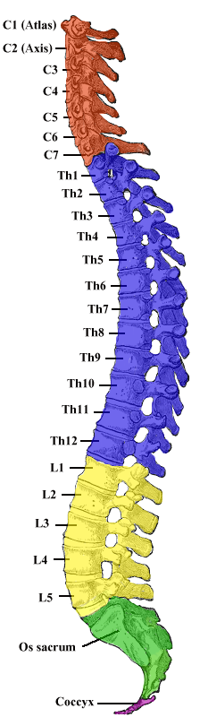

---
title: 'Back Pain BasicsAnatomy'
---

This section gives a broad overview of the anatomical structures most relevant to back pain. The goal is not to memorize every structure in detail, but to understand the main pain generators and how they relate to common clinical patterns.

## Overview of the spine

The spine is a complex structural column made up of vertebrae, intervertebral discs, joints, ligaments, muscles, nerves, and connective tissue. It supports the body, protects the spinal cord and nerve roots, and allows movement through the neck, trunk, and pelvis.

Each individual vertebra has two broad parts:

- The **vertebral body**, which is the large anterior portion that supports weight and transmits load.
- The **vertebral arch**, which is the posterior portion that surrounds the spinal canal and provides attachment points for muscles, ligaments, and joints.

## Spinal regions

The spine is divided into five major regions:

- **Cervical spine:** 7 vertebrae; designed for mobility and supports the head.
- **Thoracic spine:** 12 vertebrae; attached to the rib cage and relatively rigid.
- **Lumbar spine:** 5 vertebrae; supports much of the body's weight and allows flexion, extension, side-bending, and limited rotation.
- **Sacrum:** 5 fused vertebrae; connects the spine to the pelvis and transfers load.
- **Coccyx:** usually 3 to 5 fused vertebrae; the terminal part of the spine.

| Region | Key anatomical features | Main movement | Clinical relevance |
|---|---|---|---|
| **Cervical spine** | Smaller vertebrae, high mobility, supports the head | Flexion, extension, rotation, side-bending | Neck pain, cervical radicular pain, myelopathy |
| **Thoracic spine** | Attached to ribs, relatively rigid | Rotation more than flexion/extension | Thoracic pain is less common but may raise concern for systemic causes |
| **Lumbar spine** | Large vertebral bodies, high load-bearing role | Flexion, extension, side-bending, limited rotation | Common site of mechanical back pain, disc herniation, stenosis, and radicular pain |
| **Sacrum** | Fused vertebrae connecting spine to pelvis | Minimal movement | Forms the sacroiliac joint and transfers load to the pelvis |
| **Coccyx** | Small terminal fused vertebrae | Minimal movement | Can be involved in coccydynia after direct trauma or prolonged pressure |
: {tbl-colwidths="[18,32,22,28]"}

<figure class="figure text-center">

<figcaption>Source: <a href="https://commons.wikimedia.org/wiki/File:Gray_111_-_Vertebral_column-coloured.png">Wikimedia Commons</a>.</figcaption>
</figure>

## The spinal cord

The **spinal cord** is part of the central nervous system and runs through the **spinal canal**, which is formed by the vertebral bodies anteriorly and the vertebral arches posteriorly.

The spinal cord carries motor, sensory, and autonomic information between the brain and the body. It usually ends around the **L1-L2** vertebral level as the **conus medullaris**. Below this level, nerve roots continue downward within the spinal canal as the **cauda equina** before exiting through their respective foramina. Compression of the spinal cord, conus medullaris, or cauda equina can cause neurologic symptoms.

::: {.callout-important}
## Red flag

Cauda equina syndrome is a surgical emergency caused by compression of the cauda equina nerve roots. Key features include:

- Urinary retention
- Bowel incontinence
- Saddle anesthesia
- Motor weakness
:::

## Nerve roots and foramina

Spinal nerve roots branch from the spinal cord and cauda equina, then exit the spine through openings called **neural foramina**. These are side openings formed between adjacent vertebrae.

Nerve roots are clinically important because irritation or compression can cause **radicular pain** or **radiculopathy**.

- **Radicular pain** refers to pain generated by irritation or inflammation of a spinal nerve root. It is usually **leg-dominant** and may feel sharp, shooting, burning, or electric.
- **Radiculopathy** refers to objective nerve root dysfunction, such as weakness, sensory loss, or reflex change.

The **spinal canal** and **neural foramina** are important spaces because they can become narrowed. This narrowing is called **stenosis**.

- **Central canal stenosis** can compress multiple nerve roots and commonly causes bilateral leg heaviness, pain, or fatigue with standing or walking that improves with sitting or forward flexion.
- **Foraminal stenosis** can compress a specific exiting nerve root and more often causes unilateral dermatomal radicular pain, sometimes with weakness, sensory loss, or reflex change.

{fig-align="center" width="60%"}

::: {.callout-note}
## Key idea

Lumbar spinal stenosis often causes leg heaviness, pain, or fatigue with walking or standing, relieved by sitting or bending forward.
:::

## Intervertebral discs

The **intervertebral discs** sit between adjacent vertebral bodies and help absorb compression, distribute load, and maintain the space between vertebrae.

Each disc has two major parts:

- The **annulus fibrosus**, which is the tougher outer ring.
- The **nucleus pulposus**, which is the softer inner center.

There are two major types of disc-related pain:

- **Discogenic pain** arises from the disc itself, often in the setting of degeneration or injury.
- **Disc-related radicular pain** occurs when disc material herniates and irritates or compresses a nearby nerve root.

Discogenic pain is usually back-dominant, whereas disc-related radicular pain is typically leg-dominant and follows a nerve root distribution.

::: {.callout-note}
## Key idea

Disc-related pain may be discogenic, arising from the disc itself, or radicular, caused by disc material irritating a nearby nerve root.

Discogenic pain is often back-dominant and worse with flexion, bending forward, or prolonged sitting.

Radicular pain is typically leg-dominant and has neuropathic features.
:::

## Facet joints

The **facet joints** are paired joints at the back of the spine. They connect adjacent vertebrae and help guide and limit spinal movement.

Facet joints are especially involved in extension and rotation. They can become painful due to degeneration, overload, inflammation, or repetitive mechanical stress.

Facet-mediated pain is usually more **back-dominant** than leg-dominant. It can sometimes refer into the buttock or thigh, but it usually does not follow a clear dermatomal pattern.

::: {.callout-note}
## Key idea

Facet-mediated pain is often worse with extension and rotation, and may feel better with flexion.
:::

## Sacroiliac joint

The **sacroiliac joint**, or **SI joint**, connects the sacrum to the ilium of the pelvis. It transfers load between the spine and the lower limbs.

SI joint pain is often felt around the **posterior pelvis**, buttock, or PSIS region. It can sometimes refer into the thigh, but it usually does not follow a clear nerve root pattern.

The diagnosis usually depends on the overall clinical pattern rather than a single test.

::: {.callout-note}
## Key idea

SI joint pain is often felt near the posterior pelvis or buttock and may worsen with transitional movements, single-leg loading, or prolonged positions.
:::

## Supporting soft tissues

The spine is supported by muscles, fascia, and ligaments. Together, these structures help with posture, movement, load, and stability.

### Muscles and myofascial tissues

Paraspinal, abdominal, and other trunk muscles support movement and load tolerance. Pain arising from these tissues is often regional and movement-sensitive, and may be influenced by activity change, deconditioning, or sustained posture.

### Fascia

The thoracolumbar fascia connects the trunk and pelvic muscles and contributes to load transfer. It can be relevant to regional low-back and myofascial pain, but is usually not identified as a distinct pain generator on its own.

### Ligaments

Spinal, iliolumbar, and sacroiliac ligaments provide passive stability. They may contribute to focal pain after strain, overload, or trauma, but are difficult to identify as the sole pain generator clinically.

::: {.callout-note}
## Key idea

Muscle and fascia-related (myofascial) pain is often regional, movement-sensitive, and influenced by load, posture, conditioning, and activity tolerance. It is more often associated with tenderness, tightness, and trigger points.
:::

 

::: {.bp-pagination}
[← Previous: Introduction](back-pain-introduction.qmd){.btn .btn-outline-primary}

[All Modules](modules.qmd){.btn .btn-outline-secondary}

[Next: Clinical Patterns →](back-pain-patterns.qmd){.btn .btn-primary}
:::
