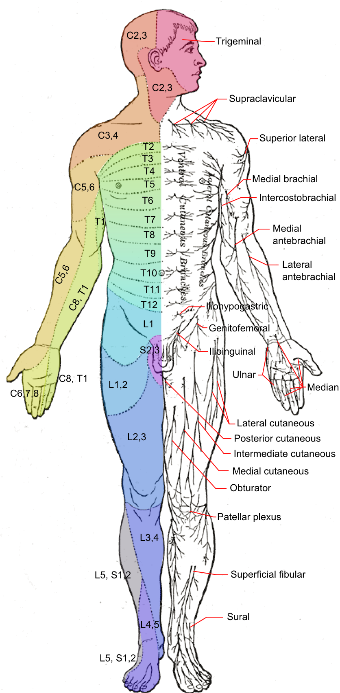
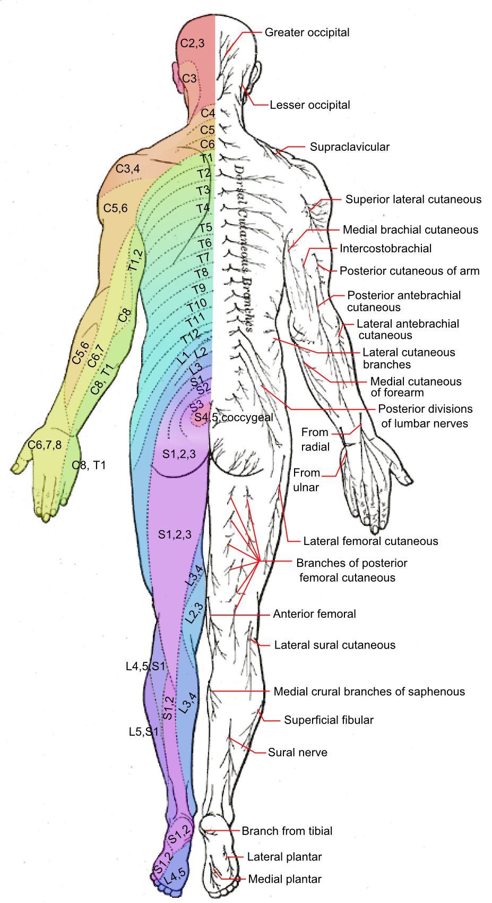
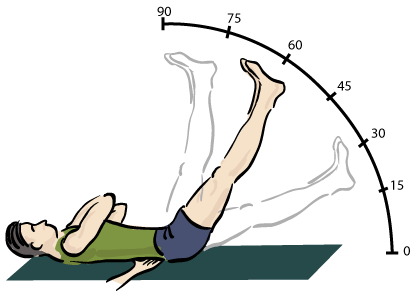
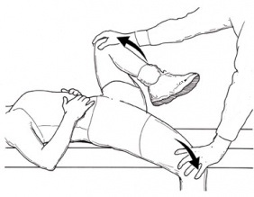

---
title: 'Back Pain BasicsPhysical Exam'
---

The physical exam should screen function, look for structural clues, assess neurologic status, and use special tests when they fit the clinical picture.

## General functional screen: 3S

Use **3S** as a quick screen of function.

### Sit-to-stand

Observe whether the patient can rise from a chair comfortably and without assistance.

### Stance

Observe whether the patient can fully straighten once standing, maintain balance, and show normal spinal alignment.

Also look for symmetry of the shoulders, hips, and knees.

### Stride

Observe gait.

Look for:

- Normal gait pattern
- Normal stride length
- Ability to turn safely and efficiently

## Inspection and palpation

Inspection and palpation should be focused on the area of pain and guided by the suspected clinical pattern. Consider nearby joints when they may contribute to perceived back pain.

### Inspection: SEADS

Look for:

- Swelling
- Erythema
- Atrophy
- Deformities
- Skin changes

### Palpation

Assess for:

- Tenderness
- Swelling
- Temperature
- Atrophy

## Neurologic exam

A neurologic screen is important when radiculopathy or neurologic compromise is possible.

Assess:

- Sensation
- Power
- Reflexes

### Sensation: dermatomes

Common lower-limb dermatomes:

- L3: medial knee
- L4: medial malleolus
- L5: dorsum of the foot
- S1: lateral foot
- S2: posterior thigh

::: {.dermatome-figures}
<figure class="figure text-center">

<figcaption>Source: <a href="https://commons.wikimedia.org/wiki/File:Dermatomes_and_cutaneous_nerves_-_anterior.png">Wikimedia Commons</a>.</figcaption>
</figure>

<figure class="figure text-center">

<figcaption>Source: <a href="https://commons.wikimedia.org/wiki/File:Dermatomes_and_cutaneous_nerves_-_posterior.png">Wikimedia Commons</a>.</figcaption>
</figure>
:::

### Power: myotomes

Common lower-limb myotomes:

- L2: hip flexion
- L3: knee extension
- L4: ankle dorsiflexion
- L5: great toe extension
- S1: ankle plantarflexion
- S2: knee flexion

### Reflexes

Key reflexes:

- L3-L4: patellar reflex
- S1-S2: Achilles reflex

## Special tests

The following are a few useful special tests for common back pain generators; they are not an exhaustive list. More complete test descriptions and interpretation are provided in the individual modules.

**Spinal deformity:**

- **Adam's forward bend test:** Assesses spinal symmetry while the patient bends forward at the hips; asymmetry of the spine or shoulders may suggest scoliosis.
- **Modified Schober's test:** Measures lumbar flexion and may identify restriction seen in inflammatory conditions such as axial spondyloarthritis.

**Radicular pain:**

- **Straight leg raise:** Reproduces radiating leg pain when the symptomatic leg is raised while the patient is supine; hamstring tightness alone is not a positive test.
- **Lasègue sign:** Re-tensions the sciatic nerve with ankle dorsiflexion after a positive straight leg raise.
- **Crossed straight leg raise:** Reproduction of symptoms in the affected leg is more specific for disc herniation.

<figure class="figure text-center">

<figcaption>Source: <a href="https://commons.wikimedia.org/wiki/File:Straight-leg-test.gif">Wikimedia Commons</a>.</figcaption>
</figure>

**Sacroiliac joint pain:**

- **FABER:** Stresses the SI joint with the hip in a figure-four position; posterior pelvic or buttock pain supports SI joint involvement, whereas groin pain suggests hip pathology.
- **Gaenslen's test:** Stresses the SI joint by extending one hip while flexing the other, and may reproduce posterior pelvic or buttock pain.

<figure class="figure text-center">

<figcaption>Source: <a href="https://commons.wikimedia.org/wiki/File:Gaenslen%27s_test.jpg">Wikimedia Commons</a>.</figcaption>
</figure>

 

::: {.bp-pagination}
[← Previous: History](back-pain-history.qmd){.btn .btn-outline-primary}

[All Modules](modules.qmd){.btn .btn-outline-secondary}

[Next: Investigations →](back-pain-investigations.qmd){.btn .btn-primary}
:::
