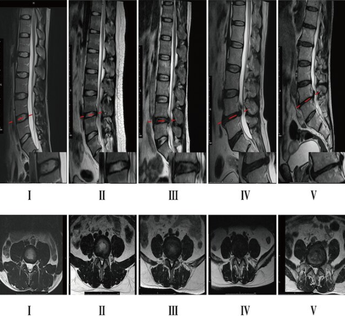
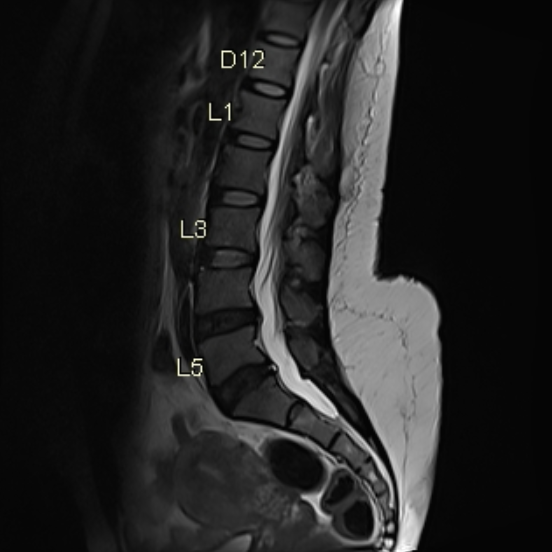
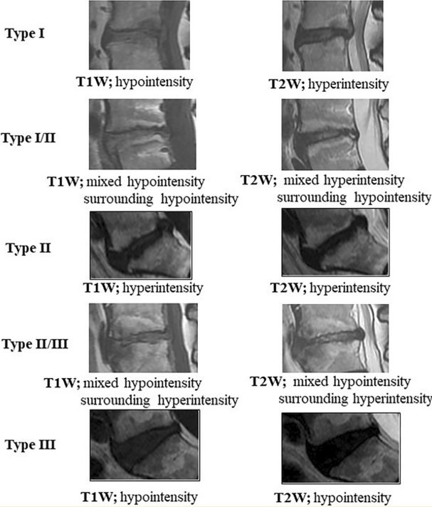

## Indications for Imaging

For acute, uncomplicated axial back pain without red flags, imaging is not indicated in the first 4 to 6 weeks; most cases improve with conservative care. Reserve imaging for:

- Red flags (see prior section)
- Persistent or disabling pain beyond approximately 6 weeks of optimal conservative management
- A patient being considered for injection, ablation, or surgery, where identifying a target pain generator matters

## Choice of Imaging

MRI is the study of choice for evaluating the disc when imaging is indicated. Plain radiographs are a reasonable initial step to screen for fracture, malignancy, or spondylolisthesis. CT is reserved for patients who cannot undergo MRI.

::: {.module-table tabindex="0" role="region" aria-label="Investigation comparison"}

| Investigation | Role |
|-|-|
| **MRI lumbar spine** | Preferred study for the disc; depicts nucleus, annulus, endplates, and neural structures, and reveals degenerative and inflammatory changes that support a discogenic source |
| **CT lumbar spine** | Alternative when MRI cannot be done; superior for bony detail but less reliable for disc and soft-tissue evaluation |
| **X-ray** | Quick screen for alignment, spondylolisthesis, fracture, and disc-space narrowing, but cannot image the disc or show its pain-generating features |

:::

Imaging in suspected discogenic pain serves two purposes: excluding other pathology (fracture, tumor, infection, nerve root compression) and identifying candidate painful levels. The central caveat is that degenerative findings are common in people without pain, so no imaging finding is diagnostic on its own and all findings must be correlated with symptoms.

## Pfirrmann Grade

The earliest and most consistent MRI marker is loss of the normal bright T2 nucleus signal, with progressive darkening, loss of nucleus-annulus distinction, and disc-height collapse. This is graded I-V on the Pfirrmann scale; grades IV-V correlate best with a positive discogram.

<figure class="figure text-center">

<figcaption>Source: <a href="https://www.researchgate.net/publication/360948782_Correlation_between_the_fatty_infiltration_of_paraspinal_muscles_and_disc_degeneration_and_the_underlying_mechanism">ResearchGate</a>.</figcaption>
</figure>

## High-Intensity Zones (HIZ)

A high-intensity zone is a focal bright T2 signal within the posterior annulus fibrosus, distinct from the nucleus, and represents a fluid- or granulation-tissue-filled annular fissure that has reached the outer, innervated annulus. When present, an HIZ is a reasonably specific marker of a painful posterior annular tear: HIZ discs frequently reproduce concordant pain at discography, and the finding correlates with grade IV-V degeneration and endplate changes. However, it is important to note that HIZs have low sensitivity, so their absence does not exclude a discogenic source, and HIZs can also appear in asymptomatic people.

<figure class="figure text-center">

<figcaption>A T2W MRI depicting a high-intensity zone (HIZ) in the posterior annulus of the intervertebral disc. Source: <a href="http://radiopaedia.org/articles/high-intensity-zone-1">Radiopaedia</a>.</figcaption>
</figure>

## Modic (Endplate) Changes and Vertebrogenic Pain

Modic changes are signal changes in the vertebral bone next to the endplate, and they mark the closely related "vertebrogenic" phenotype, where the endplate rather than the disc is the pain source. There are three types: Type 1 (edema; dark T1, bright T2) is the type most consistently linked to low back pain, Type 2 (fatty; bright T1 and T2) is more chronic, and Type 3 (sclerotic; dark on both) is least associated with pain.

::: {.module-table tabindex="0" role="region" aria-label="Type comparison"}

| Type | Marrow Change | T1 Signal | T2 Signal | Clinical Significance |
|-|-|-|-|-|
| **Type 1** | Edema/fibrovascular | Dark (hypointense) | Bright (hyperintense) | Most consistently linked to low back pain; associated with vertebrogenic pain; active/inflammatory |
| **Type 2** | Fatty marrow conversion | Bright (hyperintense) | Bright (hyperintense) | More chronic/stable; weaker, variable pain association |
| **Type 3** | Sclerotic bone | Dark (hypointense) | Dark (hypointense) | Least pain-associated; reflects endplate sclerosis |

:::

<figure class="figure text-center">

<figcaption>T1W and T2W MRI exemplars of Type I, II, and III Modic changes. Source: <a href="https://link.springer.com/article/10.1007/s00256-025-05065-3">European Radiology</a>.</figcaption>
</figure>

## Provocation Discography

Provocation discography remains the only test that directly probes whether a specific disc reproduces the patient's pain, and it is considered the reference standard for internal disc disruption, though it is invasive and controversial. Under fluoroscopy, contrast is injected into the suspect disc and at least one adjacent control disc. The test is positive when injecting the suspect disc reproduces the patient's concordant pain (>=6/10 at low pressure) while the control disc stays painless. A post-procedure CT can then assess and grade annular fissuring.

:::: {.learning-callout .learning-callout--caution .module-learning-callout role="note" aria-labelledby="discogenic-pain-investigations-callout-1"}

```{=html}
<header class="learning-callout-header">
  <svg viewBox="0 0 24 24" fill="none" stroke="currentColor" stroke-width="1.7" stroke-linecap="round" stroke-linejoin="round" aria-hidden="true"><path d="m12 3 10 18H2L12 3Zm0 6v5m0 3h.01" /></svg>
  <h3 id="discogenic-pain-investigations-callout-1">Word of caution</h3>
</header>
```

::: {.learning-callout-body}

A positive result needs both concordant pain in the suspect disc and a painless control disc. Pain alone, without a negative control, does not confirm a discogenic source.

:::

::::

::: {.dp-pagination}
[← Previous: Clinical Presentation](discogenic-pain-clinical-presentation.qmd){.btn .btn-outline-primary}

[All Modules](modules.qmd){.btn .btn-outline-secondary}

[Next: Management →](discogenic-pain-management.qmd){.btn .btn-primary}
:::