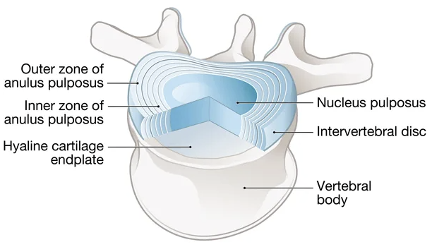
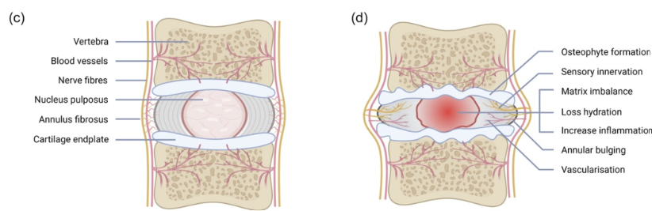
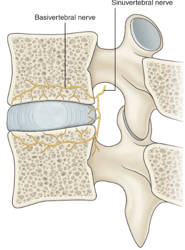

## The Intervertebral Disc

The intervertebral disc is a fibrocartilaginous joint between adjacent vertebral bodies that works as a pressurized cushion: it absorbs compression, distributes load, permits controlled motion, and maintains disc height. The three main components of the intervertebral disc are as follows:

::: {.disc-anatomy-table}
| Structure | Composition | Function |
|-|-|-|
| **Nucleus pulposus** | Gel-like core, 70-90% water, rich in aggrecan | Negative charge draws in water, generating the hydrostatic pressure that resists axial load |
| **Annulus fibrosus** | Concentric collagen lamellae angled in alternating directions | Contains the pressurized nucleus and converts compression into circumferential "hoop" tension, resisting bending and twisting |
| **Cartilaginous endplates** | Thin hyaline cartilage against each vertebral body | Anchor the disc and serve as the main route for nutrient diffusion |
:::

<figure class="figure text-center">

<figcaption>Source: <a href="https://www.pellahealth.org/services/pain-management/herniated-discs/">Pella Regional Health Center</a>.</figcaption>
</figure>

## Pain Pathway Review

Before delving further, let's quickly review how a pain signal travels from the spine to the brain. Once nociceptors in the outer annulus and endplate are activated, the signal follows a three-neuron relay to the brain.

1. **First-order neuron.** Nociceptors in the disc are activated, and the signal travels along slow A-delta and C fibers through the sinuvertebral nerve. The first-order neuron cell body lies in the dorsal root ganglion, and its central process enters the dorsal horn of the spinal cord.
2. **Synapse and crossover in the dorsal horn.** In the dorsal horn, the first-order neuron synapses on a second-order projection neuron. The signal can be amplified or dampened at this point before the second-order neuron crosses to the opposite side of the spinal cord.
3. **Second-order neuron.** After crossing, the second-order neuron ascends in the spinothalamic tract within the anterolateral spinal cord and travels to the thalamus, the brain's main sensory relay station.
4. **Third-order neuron.** The third-order neuron carries the signal from the thalamus to the primary somatosensory cortex, where the pain reaches conscious perception.

Nociceptive information ascends through parallel pathways. The lateral spinothalamic pathway projects through the thalamus to the somatosensory cortex and helps encode the location, intensity, and duration of pain. Medial pathways, including the spinoreticular and spinomesencephalic tracts, project through brainstem, thalamic, and limbic structures and contribute to the emotional, unpleasant quality of pain.

## Blood and Neural Supply

The intervertebral disc is the largest avascular structure in the body. Blood vessels reach only the outer rim of the annulus fibrosus, while the nucleus pulposus and inner annulus have no direct blood supply of their own. Instead, the disc is nourished by slow diffusion of nutrients and metabolic waste across the cartilaginous endplates, which lie between the disc and the small vessels of the adjacent vertebral bodies.

Sensory nerve fibers normally penetrate only the outermost layers of the annulus fibrosus, while the inner annulus and the entire nucleus pulposus remain nerve-free. Because pain requires functioning nociceptors, a structurally intact disc is inherently a poor generator of pain. Yet, degeneration can advance silently for years, causing pain once the disc becomes disrupted.

<figure class="figure text-center">

<figcaption>Source: <a href="https://onlinelibrary.wiley.com/doi/10.1002/jcp.31328">Journal of Cellular Physiology</a>.</figcaption>
</figure>

The disc's sensory supply is central to understanding discogenic pain, because pain is generated by a small set of specific nerves that are also the targets of diagnostic blocks and ablation. Two are most important: the sinuvertebral nerve (SVN), which supplies the disc itself, and its branch, the basivertebral nerve (BVN), which supplies the vertebral endplate.

### Sinuvertebral Nerve (SVN)

The SVN is the disc's main sensory nerve. The SVN reaches the disc and posterior longitudinal ligament by looping back through the intervertebral foramen. Its innervation overlaps across levels, with each posterior disc supplied both by its own SVN and by the SVN from the level below, an arrangement that helps explain why discogenic pain tends to be diffuse and poorly localized. It also preferentially innervates the posterior and posterolateral annulus, precisely the region where painful annular fissures concentrate.

### Basivertebral Nerve (BVN)

A branch of the SVN, the BVN is the sensory nerve of the vertebral endplate and carrier of "vertebrogenic" pain. It re-enters the vertebral body through the basivertebral foramen and runs to a central trunk (~30-50% into the body) that splits toward the superior and inferior endplates, the target of basivertebral nerve ablation.

<figure class="figure text-center">

<figcaption>Source: <a href="https://aneskey.com/basivertebral-nerve-ablation/">Basivertebral Nerve Ablation</a>.</figcaption>
</figure>

::: {.dp-pagination}
[← Introduction](discogenic-pain-introduction.qmd){.btn .btn-outline-primary}

[Next: Pathophysiology →](discogenic-pain-pathophysiology.qmd){.btn .btn-primary}
:::