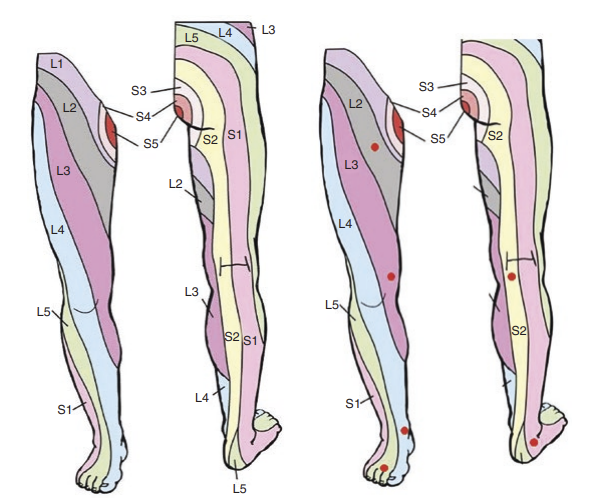
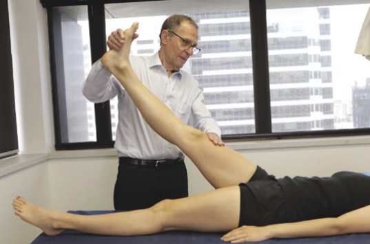
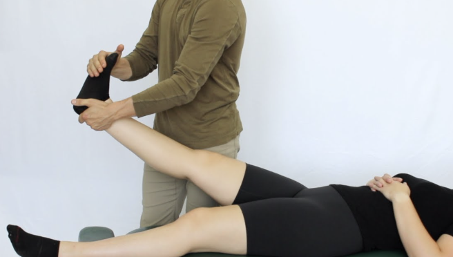
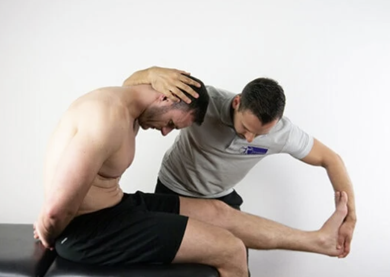
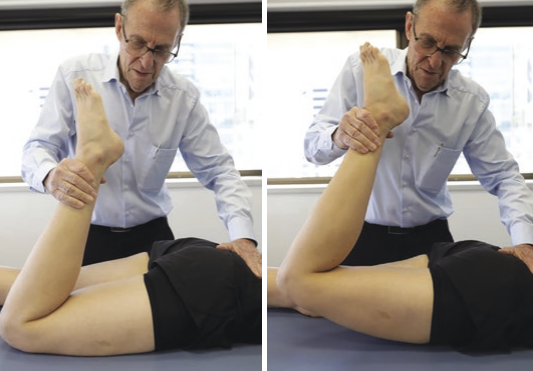
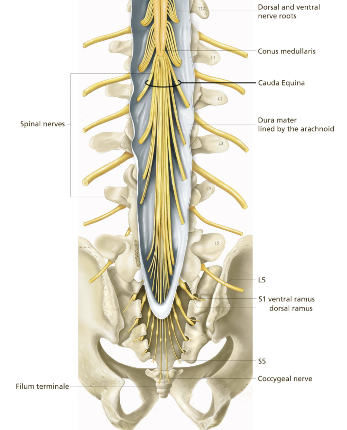

Lumbar radicular pain usually presents with **leg-dominant symptoms**.

Clinically, the stepwise approach is:

- Are there features suggesting radicular pain over other types of leg or back pain?
- Does the pain pattern fit a specific spinal nerve root level?
- Is there objective evidence of nerve root dysfunction?

## Timeline

The first distinction to make is the **duration of symptoms**.

**Acute** lumbar radicular pain often presents suddenly, especially after a lifting, bending, or twisting movement. In younger and middle-aged patients, this raises suspicion for an acute disc herniation irritating a nerve root.

**Chronic** lumbar radicular pain is usually more gradual or recurrent. In older patients, this is often related to degenerative narrowing of the lateral recess or neural foramen, which can irritate or compress the nerve root over time.

## Terminology

**Neuropathic pain** is a broad term that refers to pain generated from injury or disease affecting **any part of the nervous system** including nerves, nerve roots, the spinal cord, or the brain. 

Patients may describe this sort of pain as:

- Shooting
- Burning
- Electric
- Sharp
- Stabbing
- Traveling down the leg

**Radicular pain** specifically refers to pain generated by injury or disease to a **nerve root**. 

:::: {.learning-callout .learning-callout--idea .module-learning-callout role="note" aria-labelledby="radicular-pain-clinical-presentation-callout-1"}

```{=html}
<header class="learning-callout-header">
  <svg viewBox="0 0 24 24" fill="none" stroke="currentColor" stroke-width="1.7" stroke-linecap="round" stroke-linejoin="round" aria-hidden="true"><circle cx="12" cy="12" r="9" /><path d="M12 11v6m0-10h.01" /></svg>
  <h3 id="radicular-pain-clinical-presentation-callout-1">Key idea</h3>
</header>
```

::: {.learning-callout-body}

Radicular pain is a subtype of neuropathic pain. 

Therefore, all radicular pain is neuropathic pain, but not all neuropathic pain is radicular pain.

:::

::::

**Radiculopathy** is also related, but distinct. Remember that pain is a subjective experience, so patients can have radicular pain without objective neurologic deficits. Radiculopathy, on the other hand, implies that the nerve root is not only irritated, but also functionally impaired, leading to objecitve findings on examination.

:::: {.learning-callout .learning-callout--idea .module-learning-callout role="note" aria-labelledby="radicular-pain-clinical-presentation-callout-2"}

```{=html}
<header class="learning-callout-header">
  <svg viewBox="0 0 24 24" fill="none" stroke="currentColor" stroke-width="1.7" stroke-linecap="round" stroke-linejoin="round" aria-hidden="true"><circle cx="12" cy="12" r="9" /><path d="M12 11v6m0-10h.01" /></svg>
  <h3 id="radicular-pain-clinical-presentation-callout-2">Key idea</h3>
</header>
```

::: {.learning-callout-body}

Radicular pain describes the **subjective** pain pattern. Radiculopathy describes **objective** nerve root dysfunction.

:::

::::

::: {.module-table tabindex="0" role="region" aria-label="Term comparison"}

| Term | Meaning |
|-|---|
| **Radicular pain** | Pain generated by irritation or inflammation of a spinal nerve root |
| **Neuropathic pain** | Pain caused by injury or disease affecting the somatosensory nervous system |
| **Radiculopathy** | Objective nerve root dysfunction, such as weakness, sensory loss, or reflex change |

:::

## Symptom pattern

Symptoms may worsen with activities that increase nerve root tension or intradiscal pressure, such as:

- Sitting
- Bending forward
- Coughing
- Sneezing
- Valsalva

Depending on the cause, symptoms may also worsen with standing or extension. This is especially relevant when foraminal stenosis is the main driver.

:::: {.learning-callout .learning-callout--think .module-learning-callout role="note" aria-labelledby="radicular-pain-clinical-presentation-callout-3"}

```{=html}
<header class="learning-callout-header">
  <svg viewBox="0 0 24 24" fill="none" stroke="currentColor" stroke-width="1.7" stroke-linecap="round" stroke-linejoin="round" aria-hidden="true"><path d="M9 18h6m-5 3h4M8.5 14.5a6 6 0 1 1 7 0c-1 .7-1.5 1.5-1.5 2.5h-4c0-1-.5-1.8-1.5-2.5Z" /></svg>
  <h3 id="radicular-pain-clinical-presentation-callout-3">Pause and think</h3>
</header>
```

::: {.learning-callout-body}

In the opening case, the patient develops acute radiating leg pain after deadlifting. Which movement would you expect to aggravate his pain more: lumbar flexion or lumbar extension?

<details>
<summary>Show answer</summary>

**Lumbar flexion** would be more likely to aggravate his pain.

Because the symptoms are acute and started during lifting, an acute disc herniation is higher on the differential. Disc-related radicular pain is often worsened by flexion, sitting, bending forward, coughing, or Valsalva.

By contrast, pain from degenerative foraminal stenosis is often worse with **lumbar extension**, because extension can further narrow the neural foramen.

</details>

:::

::::

## Dermatomes

A **dermatome** is an area of skin supplied mainly by one spinal nerve root.

In radicular pain, the pain or sensory symptoms may follow a dermatomal pattern. For example, irritation of the L5 nerve root often causes symptoms that travel down the lateral leg toward the dorsum of the foot.

::: {.module-table tabindex="0" role="region" aria-label="Nerve root comparison"}

| Nerve root | Broad sensory distribution |
|---|---|
| **L2** | Anterior upper thigh |
| **L3** | Anterior thigh and medial knee |
| **L4** | Medial leg and medial ankle |
| **L5** | Lateral leg, dorsum of foot, great toe |
| **S1** | Posterior leg, lateral foot, sole |
| **S2** | Posterior thigh and upper posterior calf |
: {tbl-colwidths="[20,80]"}

:::

{fig-align="center" width="45%"}

## Myotomes and reflexes

A **myotome** is a group of muscles supplied mainly by one spinal nerve root.

Myotomes help identify whether radicular pain has progressed to **radiculopathy**. Weakness in a myotomal pattern suggests that the affected nerve root is not only irritated, but also functionally impaired.

::: {.module-table tabindex="0" role="region" aria-label="Root comparison"}

| Root | Motor findings | Reflex |
|---|---|---|
| **L3** | Hip flexion, knee extension | Patellar may be reduced |
| **L4** | Knee extension, ankle dorsiflexion | Patellar |
| **L5** | Great toe extension, ankle dorsiflexion, hip abduction | No reliable reflex |
| **S1** | Plantarflexion, toe walking | Achilles |
: {tbl-colwidths="[20,55,25]"}

:::

:::: {.learning-callout .learning-callout--think .module-learning-callout role="note" aria-labelledby="radicular-pain-clinical-presentation-callout-4"}

```{=html}
<header class="learning-callout-header">
  <svg viewBox="0 0 24 24" fill="none" stroke="currentColor" stroke-width="1.7" stroke-linecap="round" stroke-linejoin="round" aria-hidden="true"><path d="M9 18h6m-5 3h4M8.5 14.5a6 6 0 1 1 7 0c-1 .7-1.5 1.5-1.5 2.5h-4c0-1-.5-1.8-1.5-2.5Z" /></svg>
  <h3 id="radicular-pain-clinical-presentation-callout-4">Pause and think</h3>
</header>
```

::: {.learning-callout-body}

The patient from the earlier case now seems to have weakness with great toe extension on exam. Which nerve root would this make you most concerned about?

<details>
<summary>Show answer</summary>

Great toe extension is commonly used to assess the L5 nerve root. Weakness here would make L5 radiculopathy more likely.

</details>

:::

::::

## Provocative tests

Provocative tests can support the diagnosis by increasing tension on irritated nerve roots. A positive result on these tests increases your suspicion for lumbar radicular pain. 

**Straight leg raise (Lasègue test).** With the patient lying supine, passively raise the straightened leg to about 30–70° and assess whether this reproduces radiating leg pain. A positive result suggests lower lumbar radicular irritation, especially involving L5 or S1.

**Crossed straight leg raise.** Raise the unaffected leg and assess whether this reproduces radicular pain in the symptomatic leg. This test is less sensitive but more specific for disc herniation.

{fig-align="center" width="45%"}

**Bragard test.** After a positive straight leg raise, slightly lower the leg until pain improves, then dorsiflex the ankle to see if radicular pain returns. This supports neural tension or lower lumbar radicular irritation.

{fig-align="center" width="45%"}

**Slump test.** With the patient seated, flex the spine and neck, extend the knee, and dorsiflex the ankle to tension the neural system. A positive result suggests neural tension or radicular irritation.

{fig-align="center" width="45%"}

**Femoral stretch test.** With the patient prone or side-lying, extend the hip and flex the knee to stretch the femoral nerve. A positive result suggests upper lumbar radicular irritation, especially involving L2 to L4.

{fig-align="center" width="45%"}

:::: {.learning-callout .learning-callout--caution .module-learning-callout role="note" aria-labelledby="radicular-pain-clinical-presentation-callout-5"}

```{=html}
<header class="learning-callout-header">
  <svg viewBox="0 0 24 24" fill="none" stroke="currentColor" stroke-width="1.7" stroke-linecap="round" stroke-linejoin="round" aria-hidden="true"><path d="m12 3 10 18H2L12 3Zm0 6v5m0 3h.01" /></svg>
  <h3 id="radicular-pain-clinical-presentation-callout-5">Word of caution</h3>
</header>
```

::: {.learning-callout-body}

Be careful not to misinterpret hamstring tightness or other forms of non-radicular discomfort as a positive test. Hamstring tightness is often felt as a localized pulling, stretching, or aching sensation in the back of the thigh, without the patient's usual electric or shooting pain traveling below the knee. A positive result specifically refers to reproduction of the patient’s typical radiating leg pain, which often travels into the calf, foot, or toes.

:::

::::

:::: {.learning-callout .learning-callout--think .module-learning-callout role="note" aria-labelledby="radicular-pain-clinical-presentation-callout-6"}

```{=html}
<header class="learning-callout-header">
  <svg viewBox="0 0 24 24" fill="none" stroke="currentColor" stroke-width="1.7" stroke-linecap="round" stroke-linejoin="round" aria-hidden="true"><path d="M9 18h6m-5 3h4M8.5 14.5a6 6 0 1 1 7 0c-1 .7-1.5 1.5-1.5 2.5h-4c0-1-.5-1.8-1.5-2.5Z" /></svg>
  <h3 id="radicular-pain-clinical-presentation-callout-6">Pause and think</h3>
</header>
```

::: {.learning-callout-body}

On exam, the patient has pain radiating down the leg during a straight leg raise, but no pain during the femoral stretch test. What does this suggest?

<details>
<summary>Show answer</summary>

This pattern supports **lower lumbar nerve root irritation**, especially involving the **L5 or S1 nerve roots**.

A positive straight leg raise is more consistent with lower lumbar radicular pain, while the femoral stretch test is more useful for upper lumbar nerve root irritation, especially **L2 to L4**.

</details>

:::

::::

## Red flag features

Red flag features should be screened for because not all radiating leg pain is benign.

They can be remembered using the **NIFTI** mnemonic:

::: {.module-table tabindex="0" role="region" aria-label="Category comparison"}

| Category | Features |
|---|---|
| **N**eurologic | New urinary retention or overflow incontinence, saddle anesthesia, bilateral severe neurologic symptoms, or progressive motor weakness |
| **I**nfection | Fever, immunosuppression, IV drug use, or other concern for infection |
| **F**racture | Significant trauma |
| **T**umour | History of malignancy, unexplained weight loss, or severe unremitting night pain |
| **I**nflammation | Onset before age 45 with prolonged morning stiffness, improvement with exercise, or pain that does not improve with rest |
: {tbl-colwidths="[20,80]"}

:::

{fig-align="center" width="45%"}

<br>

::: {.rp-pagination}
[← Previous: Relevant Anatomy](radicular-pain-relevant-anatomy.qmd){.btn .btn-outline-primary}

[All Modules](modules.qmd){.btn .btn-outline-secondary}

[Next: Investigations →](radicular-pain-investigations.qmd){.btn .btn-primary}
:::
