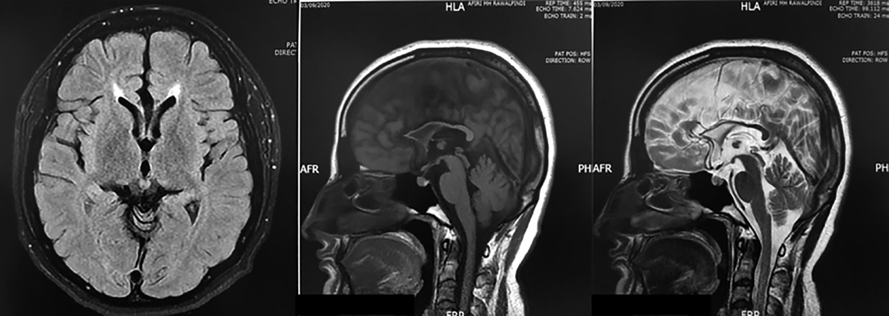
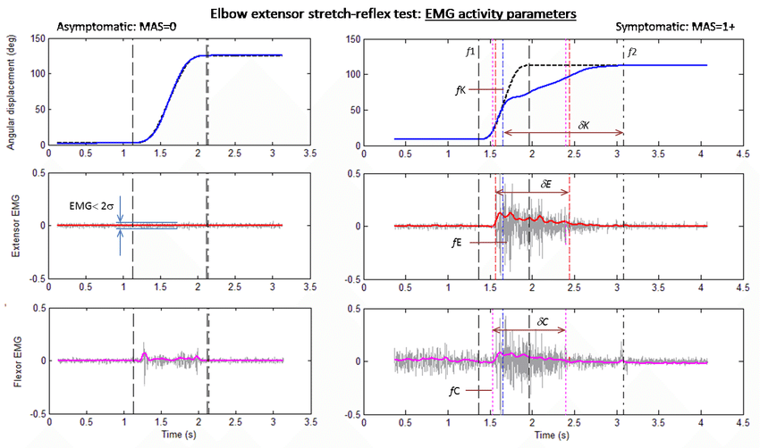
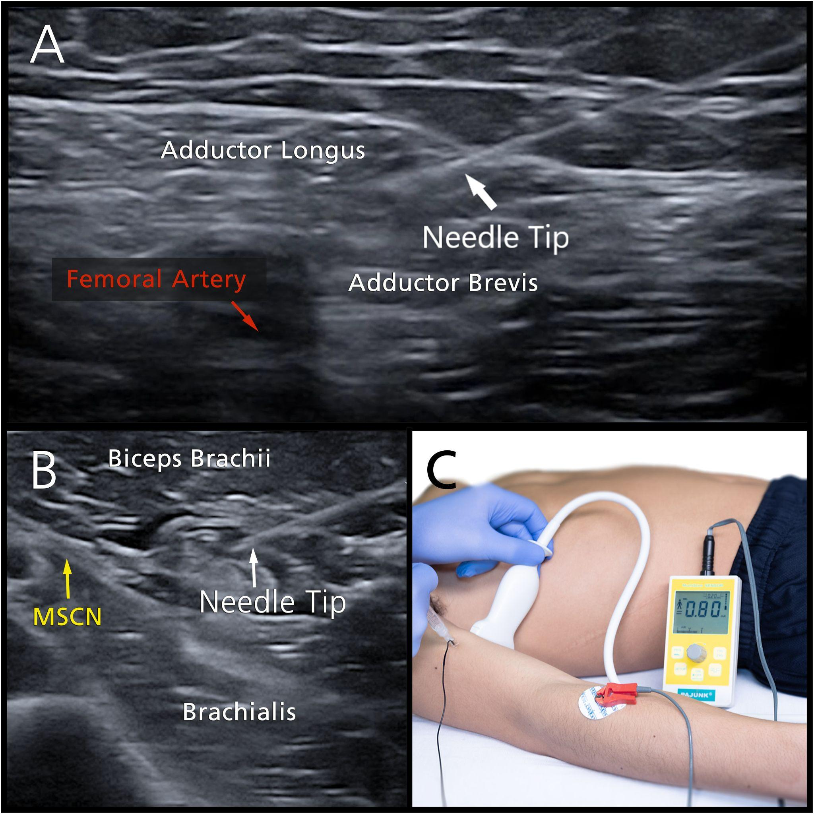
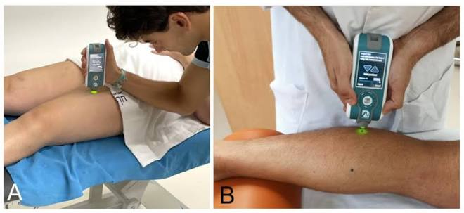

How should spasticity be investigated once a patient presents with it? Generally speaking, the physical examination is sufficient to identify spasticity, and it can already guide treatment planning. Further investigations are usually directed at identifying lesions and other pathologies underlying spasticity and are important for treating the root cause. Imaging is usually ordered when the diagnosis is unclear or the spasticity is new onset.

## MRI

MRI of the brain and spinal cord can identify structural lesions in the central nervous system that may underlie abnormal muscle tone. Examples include:

- Stroke
- Multiple sclerosis
- Spinal cord compression
- Other structural central nervous system lesions

Characteristic findings may sometimes support hereditary disorders, such as hereditary spastic paraplegia. For example, an "ear of the lynx" sign and thinning of the genu and body of the corpus callosum may be seen in some patients.

<figure class="figure text-center">

<figcaption>An example of a patient with Hereditary Spastic Paraplegia, note the clear “ear of lynx” sign on the left image, and marked thinning of the genu and body of corpus callosum in the second and third image. Source: <a href="https://jcpsp.pk/article-detail/phereditary-spasticbr-or%20paraplegia-role-of-mriorp">JCPSP</a>.</figcaption>
</figure>

## Electromyography and Nerve Conduction Studies

Spasticity is primarily a clinical diagnosis. Needle or surface EMG can help identify overactive muscles and quantify abnormal muscle activation or stretch reflexes, but EMG is not routinely required to diagnose spasticity. Nerve conduction studies are a separate test and are not a form of surface EMG.

Needle EMG involves inserting a needle into the muscle and recording electrical activity. Surface EMG uses electrodes placed on the skin to measure muscle activity. In selected cases, EMG may demonstrate involuntary muscle activity at rest or abnormal muscle firing, such as dynamic or static stretch reflexes during passive movement.

<figure class="figure text-center">

<figcaption>Image showing a comparison of muscle activity between of a spastic patient (right) vs a normal control (left) as recorded on EMG. Red vertical lines show the onset of spasticity. Source: <a href="https://www.researchgate.net/figure/Elbow-kinematic-profile-and-predicted-spasticity-onset-time-from-kinematic-data-blue_fig2_315350300">ResearchGate</a>.</figcaption>
</figure>

## Nerve Blocks

Nerve blocks are a focused method of assessment involving injection of local anesthetic around a specific motor nerve to temporarily reduce activity in a small muscle group. This can serve as a test of the expected functional effects of reducing muscle activity and can help assess how activities of daily living may be affected or improved.

Nerve blocks can help guide longer-lasting focal treatment such as botulinum toxin injection or neurolysis, and can also assist with therapy and surgical planning. They can be performed in a clinic setting and are usually guided by ultrasound.

<figure class="figure text-center">

<figcaption>This image shows how ultrasound guided nerve blocks would look. Source: <a href="https://pubmed.ncbi.nlm.nih.gov/34673709/">Winston et al., <em>Ultrasound With E-Stimulation Diagnostic Nerve Blocks for Targeted Muscle Selection in Spasticity</em></a>.</figcaption>
</figure>

## Myotonometry

Myotonometry offers a quantitative measurement of muscle mechanical properties. It measures tissue displacement in response to a perpendicular compression force and can provide an adjunct quantitative assessment of muscle compliance. Tonic contractures can change muscle compliance, which may be reflected in the myotonometric reading.

Myotonometry is an adjunctive tool rather than a routine diagnostic test and should be interpreted alongside the clinical examination. It may help characterize muscle stiffness and monitor change over time, but it does not independently establish the diagnosis of spasticity or reliably distinguish spasticity from joint stiffness in every patient.

<figure class="figure text-center">

<figcaption>Image shows an example of a myotonometer and how it is used. Source: <a href="https://pmc.ncbi.nlm.nih.gov/articles/PMC5345015/">PMC</a>.</figcaption>
</figure>

::: {.sp-pagination}
[← Previous: Clinical Presentation](spasticity-clinical-presentation.qmd){.btn .btn-outline-primary}

[All Modules](modules.qmd){.btn .btn-outline-secondary}

[Next: Management →](spasticity-management.qmd){.btn .btn-primary}
:::