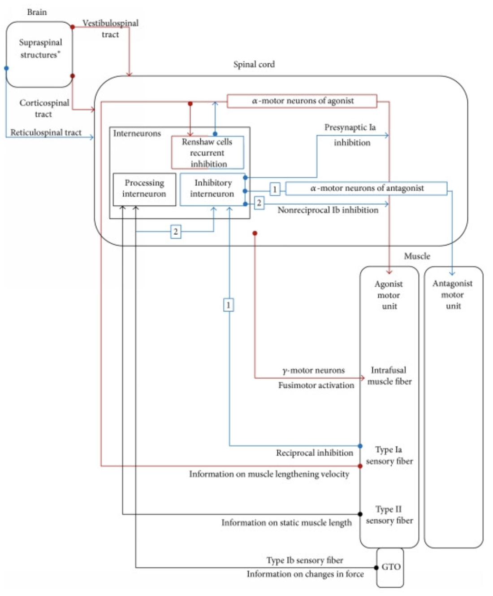
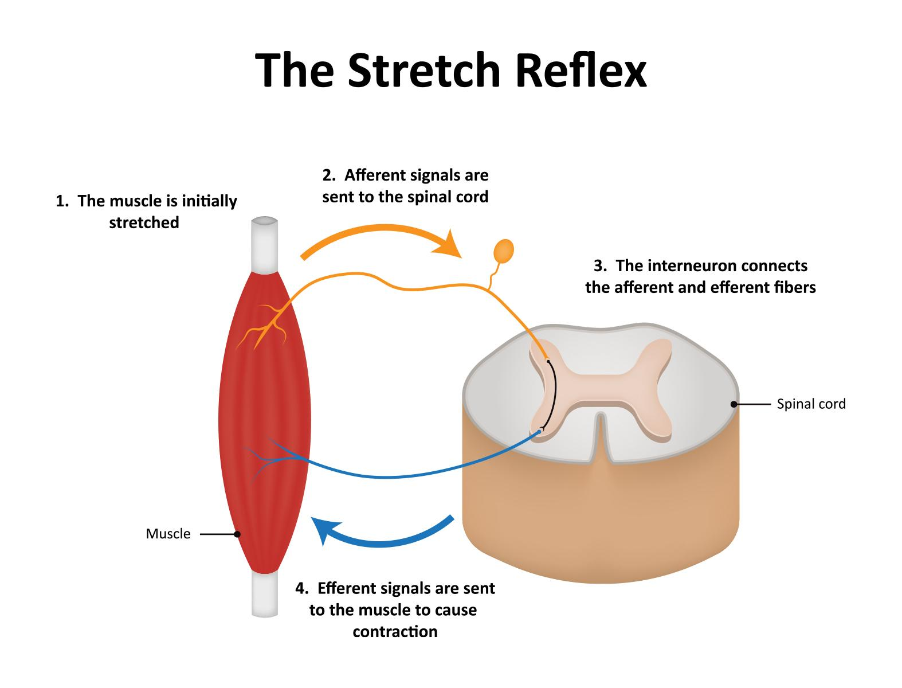
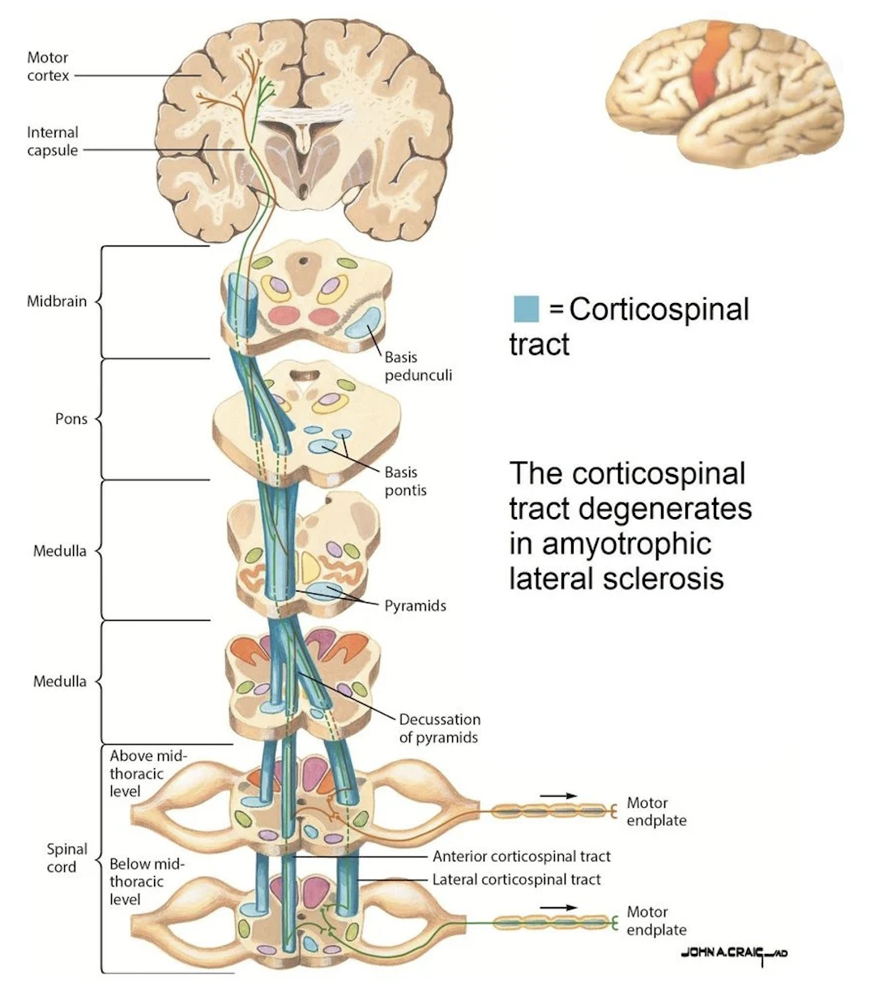
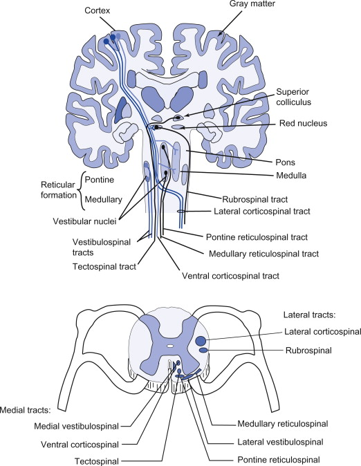
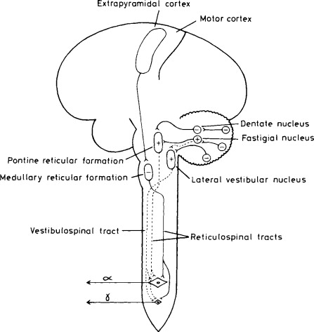
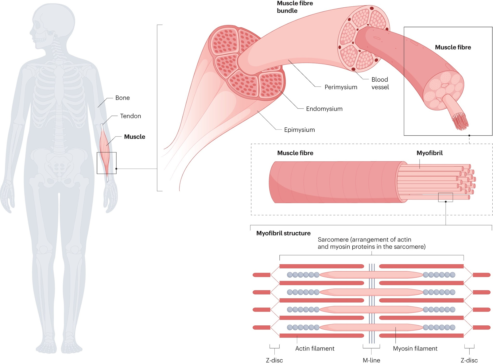
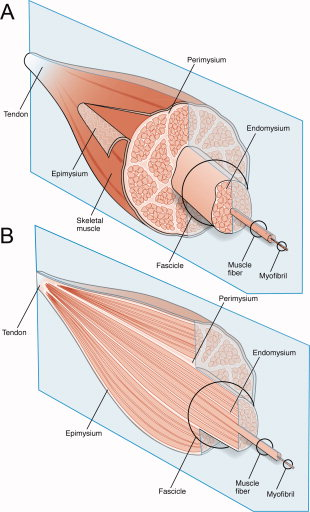

The mechanisms and pathways that underlie the development of spasticity have not been fully elucidated. Presently, the main identifying factors are abnormal intraspinal processing of afferent signals, loss of descending supraspinal inhibition of reflex arcs, decreased inhibitory control of corticospinal tracts, and increased motor neuron excitability. The following sections offer an overview of the relevant anatomy.

## Big Picture

The cerebral cortex is essential for sending commands for voluntary movement. The frontal motor area forms corticospinal pathways. Premotor and supplementary motor cortices are important for sequencing and modulating voluntary movements. The prefrontal cortex plans movement, while parietal areas guide movement. Association areas use conscious and unconscious information to further guide movement.

Subcortical centers, including the basal ganglia and cerebellum, maintain tone, posture, and coordination. The brainstem, particularly the pons and medullary reticular nuclei, vestibular nuclei, and red nuclei, is an important station that modulates stretch reflexes, posture, and repetitive movements.

The spinal cord contains complex neuronal circuits and is also the area of interface between upper and lower motor neurons. It involves:

- **Motor unit:** A motor neuron and all the muscle fibers it innervates.
- **Spinal cord reflexes.**

<figure class="figure text-center">

<figcaption>Source: <a href="https://pmc.ncbi.nlm.nih.gov/articles/PMC4229996/#sec3">PMC</a>.</figcaption>
</figure>

## Reflex Pathways

In healthy individuals, stretch reflexes are mediated by excitatory connections between alpha motor neurons and the Ia afferent fibers from muscle spindles. Passive stretch of the muscle excites muscle spindles, causing Ia fibers to fire and send input to alpha motor neurons through spinal pathways. The alpha motor neurons send an efferent impulse to the muscle, causing it to contract.

Golgi tendon organs sense tension and send signals via Ib afferents. Golgi tendon organ Ib afferents provide inhibitory input in response to muscle tension, helping regulate excessive contraction.

<figure class="figure text-center">

<figcaption>Source: <a href="https://doi.org/10.4324/9781315110745">David G. Behm, <em>The Science and Physiology of Flexibility and Stretching</em></a>.</figcaption>
</figure>

In patients with spasticity, the stretch reflex is exaggerated. Two theoretical causes are:

- Increased excitability of muscle spindles.
- Abnormal processing of sensory inputs from normal muscle spindles in the spinal cord. This is the more widely accepted theory.

## Descending Pathways of Control

### Corticospinal Tract

The corticospinal tract is important for voluntary motor control and also receives and modulates inputs from other sources. Lesions of the corticospinal tract alone do not usually cause spasticity; involvement of other tracts is generally required.

<figure class="figure text-center">

<figcaption>Source: <a href="https://www.researchgate.net/figure/Corticospinal-tract-blue-conveying-motor-signals-from-motor-cortex-to-skeletal-muscles_fig1_237008975">ResearchGate</a>.</figcaption>
</figure>

### Reticulospinal Tract

The reticulospinal tract is the pathway most commonly implicated in spasticity. The dorsal reticulospinal pathway is inhibitory to the stretch reflex, while the medial, or pontine, reticulospinal tract is facilitatory. Therefore, when only the dorsal tract is disturbed, the system is pushed toward hyperexcitability.

Direct evidence shows upregulated reticulospinal output in subjects who develop spasticity after spinal cord injury.

<figure class="figure text-center">

</figure>

### Vestibulospinal Tract

The vestibulospinal tract facilitates extensor tone and is important in maintaining posture and balance. Its unopposed activity can cause increased tone.

<figure class="figure text-center">

<figcaption>Source: <a href="https://www.sciencedirect.com/science/article/pii/B9780407001961500115">ScienceDirect</a>.</figcaption>
</figure>

## Muscle Fibers and Extracellular Matrix

Skeletal muscle is organized hierarchically: whole muscle → fascicle → muscle fiber → myofibril → sarcomere.

The muscle fiber is the basic cellular unit of skeletal muscle. It is multinucleated and bound by the sarcolemma. A myofibril is composed of serially repeating sarcomeres joined at Z-lines. Sarcomeres are the smallest fundamental contractile units. They are formed by myosin and actin filaments, which form cross-bridges and shorten in a process driven by ATP.

In spasticity, fiber-level architecture is disrupted.

<figure class="figure text-center">

<figcaption>Source: <a href="https://www.nature.com/articles/s41572-023-00469-8">Nature</a>.</figcaption>
</figure>

The extracellular matrix contains three connective tissue layers:

- **Endomysium:** The innermost layer of collagen fibers, which anchors onto the sarcolemma and is important for lateral force transmission.
- **Perimysium:** Surrounds each fascicle and carries blood vessels and nerves. Large collagen fibers are a site of pathological stiffening in contractures.
- **Epimysium:** The outermost dense collagen sheath around the whole muscle. It helps transmit force from fibers to the skeleton.

<figure class="figure text-center">

<figcaption>Source: <a href="https://pmc.ncbi.nlm.nih.gov/articles/PMC3177172/">Gillies AR, Lieber RL. <em>Structure and Function of the Skeletal Muscle Extracellular Matrix</em></a>.</figcaption>
</figure>

In spasticity, many changes occur at the extracellular matrix and muscle fiber levels. For example, there may be a reduced number of sarcomeres, or sarcomeres may be held at longer-than-optimal lengths.

Passive fiber mechanics are typically unaltered, and increased stiffness is usually due to alterations in the extracellular matrix. Collagen accumulates in contracted muscle, which directly increases stiffness.

::: {.sp-pagination}
[← Previous: Introduction](spasticity-introduction.qmd){.btn .btn-outline-primary}

[All Modules](modules.qmd){.btn .btn-outline-secondary}

[Next: Clinical Presentation →](spasticity-clinical-presentation.qmd){.btn .btn-primary}
:::