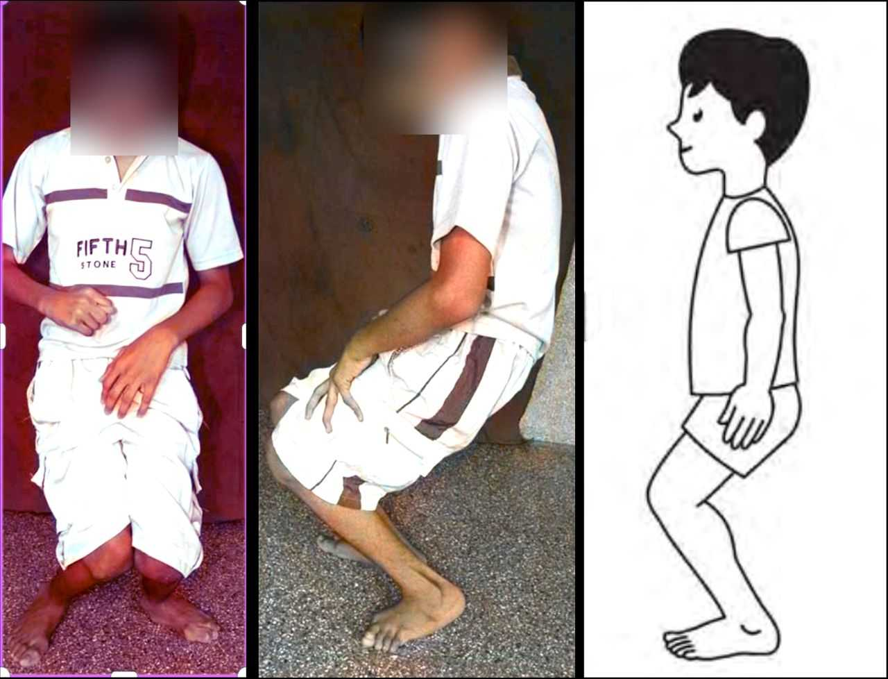
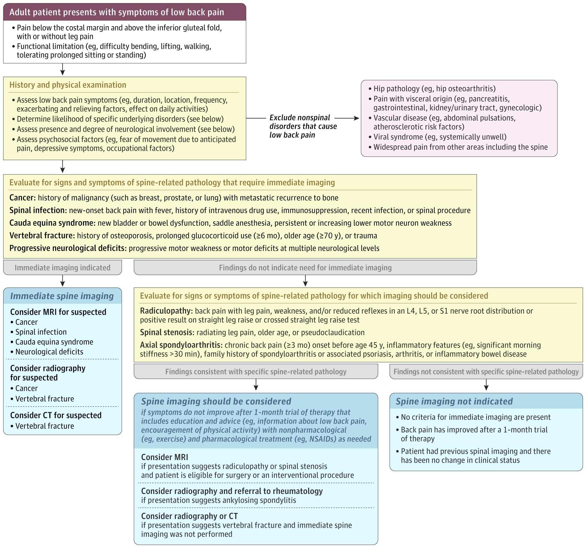

## Asymptomatic presentation

Most pars defects and slips are silent and are found incidentally. Slip magnitude correlates poorly with pain, and many patients, including those with isthmic disease, remain functional for years.

## Low back pain

Mechanical pain is provoked by activity, prolonged standing, and lumbar extension and is relieved by rest or flexion. Isthmic disease and spondylolysis classically worsen with hyperextension and repetitive loading, particularly in adolescents and athletes.

Referred nonradicular pain to the buttock, hip, or posterior thigh may reflect facet or discogenic sources.

## Radicular symptoms

Dermatomal leg pain can result from foraminal narrowing at the slip level. L5 symptoms are typical in isthmic L5–S1 slips, while L4 or L5 symptoms may occur in degenerative L4–L5 slips.

Degenerative slips with central or lateral-recess stenosis can cause neurogenic claudication: bilateral leg heaviness with walking or standing that is relieved by sitting or lumbar flexion. Patients may adopt a wide-based gait.

## Neurologic deficits

Dermatomal sensory loss, myotomal weakness, and diminished reflexes can localize the affected level, although these findings are less common than pain alone.

::: {.callout-important}
## Red flag

Cauda equina syndrome is rare but must be excluded. New urinary retention or incontinence, saddle anesthesia, reduced anal tone, or progressive or bilateral weakness require emergent MRI and urgent surgical referral.
:::

## Hamstring tightness

Hamstring tightness is a hallmark finding, especially in adolescents with higher-grade isthmic slips. It may present as reduced forward bending, limited straight-leg raise, and a stiff, short-stride gait. It is thought to be a protective response to instability rather than true neural tension and should raise suspicion in a young athlete with activity-related back pain.

## Gait and postural abnormalities

Lumbosacral kyphosis and pelvic retroversion can produce a flattened lumbar contour, palpable step-off, shortened trunk, and, in severe L5–S1 slips, a crouched Phalen-Dickson gait. Degenerative stenosis instead tends to produce a forward-flexed posture and wide-based gait.

<figure class="figure text-center">

<figcaption>“Images of a ‘crouched’ gait (Phalen-Dickson sign), featuring excessive hip flexion, knee flexion, and ankle dorsiflexion.” Source: <a href="https://pinnacleorthocentre.com/crouch-gait-in-cerebral-palsy/">Pinnacle Orthocentre</a>.</figcaption>
</figure>

## Physical examination

The examination emphasizes:

- **Inspection and palpation:** Assess posture, lumbar contour, and a midline step-off; identify localized tenderness at the affected segment.
- **Range of motion:** Assess flexion, extension, and rotation. Pain may be reproduced with lumbar hyperextension or, in athletes, single-leg hyperextension.
- **Neurologic testing:** Test motor strength, sensation, and reflexes by myotome and dermatome. Perform a straight-leg raise when radicular tension signs are suspected.
- **Hamstring and gait assessment:** Assess the popliteal angle and observe for a short-stride or crouched gait.

## Differential diagnosis

The clinical picture overlaps with other mechanical and radicular causes of back and leg pain, several of which may coexist with a slip.

- **Lumbar disc herniation:** Younger patients with acute, leg-dominant dermatomal pain that is worse with sitting and may be accompanied by a positive straight-leg raise.
- **Lumbar spinal stenosis:** Older patients with neurogenic claudication and leg pain relieved by flexion; degenerative spondylolisthesis is itself a common cause.
- **Facet joint or discogenic pain:** Axial pain with referral to the hip or thigh and no focal neurologic deficit.
- **Sacroiliac joint dysfunction:** Buttock pain worse with sit-to-stand transitions, tenderness over the sacroiliac joint, and pain that does not localize above L5.
- **Hip pathology:** Osteoarthritis or femoroacetabular impingement can cause groin or anterior-thigh pain with painful or limited hip rotation.

::: {.callout-warning}
## Cannot-miss diagnoses

Cauda equina syndrome, spinal epidural abscess, and spinal malignancy can mimic mechanical back pain. Fever, intravenous drug use, immunosuppression, markedly elevated ESR or CRP, age over 50, a history of cancer, unexplained weight loss, or night pain should prompt MRI and directed workup.
:::

A structured diagnostic algorithm helps separate the majority of patients with nonspecific pain from the minority with serious or specific pathology.

<figure class="figure text-center">

<figcaption>Source: Cashin AG, Chou R, Weimer MB, McAuley JH. Low Back Pain: A Review. <em>JAMA</em>. 2026;336(2):144–158. <a href="https://doi.org/10.1001/jama.2026.9631">JAMA</a>.</figcaption>
</figure>

 

::: {.sl-pagination}
[← Previous: Pathophysiology](spondylolisthesis-pathophysiology.qmd){.btn .btn-outline-primary}

[All Modules](modules.qmd){.btn .btn-outline-secondary}

[Next: Diagnosis →](spondylolisthesis-diagnosis.qmd){.btn .btn-primary}
:::
