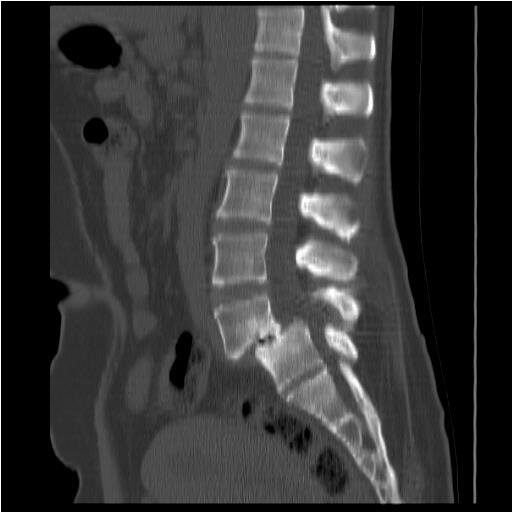
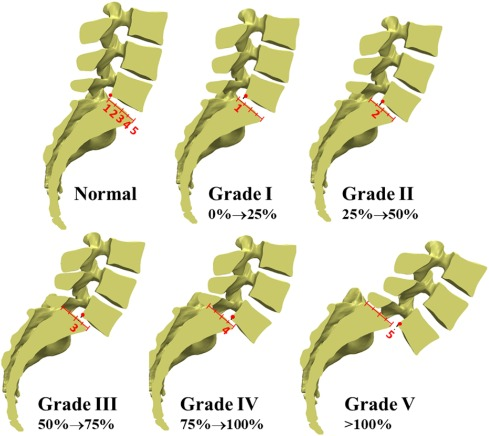

## History and physical examination

Isthmic disease commonly presents with activity-related axial pain worsened by extension, rotation, and loading. Degenerative disease presents in older adults and often includes neurogenic claudication.

Key findings include segmental tenderness, painful or limited extension, hamstring tightness, and a focused neurologic examination assessing strength, sensation, reflexes, and straight-leg raise. These findings are more sensitive than specific, and pain-free extension does not exclude the diagnosis.

## Plain radiographs

Standing lateral radiographs are the initial test for detecting and grading a slip. Upright positioning is essential because a slip may reduce when the patient is supine. Anteroposterior and lateral views can demonstrate both spondylolysis and spondylolisthesis.

<figure class="figure text-center">

<figcaption>“A sagittal radiograph depicting grade II spondylolisthesis located between the L4-L5.” Source: <a href="https://radiopaedia.org/articles/spondylolisthesis-1">Radiopaedia</a>.</figcaption>
</figure>

## Flexion-extension radiographs

Standing flexion-extension views are the traditional standard for detecting dynamic instability, which can influence surgical planning. However, their reliability is debated because they may underestimate instability. Upright radiographs combined with supine MRI, or natural sitting lateral views, may detect unstable cases more effectively.

## Computed tomography

CT provides the best bony detail for characterizing a pars defect, including cortical integrity, fracture acuity, and sclerosis. It is also useful for surgical planning. CT or CT myelography can assess neural compression when MRI is contraindicated. Radiation exposure is an important consideration in young patients.

## Magnetic resonance imaging

MRI is the best noninvasive test for evaluating neural compression in the central canal, lateral recesses, and neural foramina, and it avoids radiation. In adolescents, MRI can detect an early stress reaction with marrow edema before a frank fracture develops.

A facet effusion greater than 1.5 mm on supine MRI suggests a reducible degenerative slip and should prompt standing radiographs.

## Assessment of slip grade

Slip severity is graded using the Meyerding classification on a standing lateral radiograph, based on the percentage of anterior translation:

::: {.module-table tabindex="0" role="region" aria-label="Grade comparison"}

| Grade | Percentage of translation | Classification |
|---|---:|---|
| **I** | 0–25% | Low-grade |
| **II** | 25–50% | Low-grade |
| **III** | 50–75% | High-grade |
| **IV** | 75–100% | High-grade |
| **V** | >100% | Spondyloptosis |
: {tbl-colwidths="[18,37,45]"}

:::

<figure class="figure text-center">

<figcaption>Source: <a href="https://www.sciencedirect.com/science/article/abs/pii/S174680942030478X">ScienceDirect</a>.</figcaption>
</figure>

## Assessment of spinal and spinopelvic alignment

Full-length standing radiographs allow measurement of spinopelvic parameters that guide progression risk assessment and surgical planning. Important measurements include pelvic incidence, pelvic tilt, sacral slope, lumbar lordosis, and sagittal vertical axis.

Pelvic incidence is fixed and individual-specific:

$$\mathrm{PI} = \mathrm{PT} + \mathrm{SS}$$

High pelvic incidence is associated with both isthmic and degenerative disease and correlates with slip grade and progression.

 

::: {.sl-pagination}
[← Previous: Clinical Presentation](spondylolisthesis-clinical-presentation.qmd){.btn .btn-outline-primary}

[All Modules](modules.qmd){.btn .btn-outline-secondary}

[Next: Management →](spondylolisthesis-management.qmd){.btn .btn-primary}
:::
