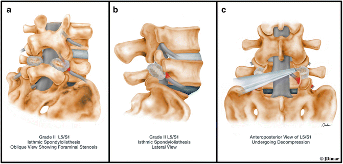

## Nonoperative management

Most symptomatic spondylolysis and low-grade spondylolisthesis respond to nonoperative care. This is the appropriate first-line approach for patients without a neurologic deficit.

Core components include:

- **Activity modification and load management:** Temporarily stop aggravating, especially extension-based, sports. Athletes typically rest for approximately six weeks, then gradually return based on symptoms.
- **Physical therapy:** Emphasize core and trunk stabilization, hamstring flexibility, and correction of postural and biomechanical factors. Physical therapy is the most consistently appropriate nonoperative measure across clinical scenarios.
- **NSAIDs:** Use for pain control when clinically appropriate.
- **Epidural or transforaminal steroid injections:** Consider when radicular symptoms are prominent.
- **Bracing:** A TLSO may be used chiefly in pediatric or adolescent cases. Its value is debated because healing and return-to-play outcomes may be similar with or without bracing.

::: {.callout-note}
## Key idea

In pediatric patients, dysplastic spondylolisthesis carries a higher risk of progression and warrants surveillance radiographs every 6–9 months.
:::

## Indications for surgery

Surgery is considered for patients who fail at least six months of conservative management or who have higher-risk features. Key indications include:

- High-grade slip, defined as Meyerding grade III–V
- Progression of slippage, such as progression by more than one grade or documented instability
- Neurologic deficit, persistent or refractory radiculopathy, or neurogenic claudication
- Documented instability, including at least 5 mm of translation or at least 20° greater angular motion than the adjacent level on flexion-extension imaging in isthmic disease

## Surgical management

Surgical strategy is tailored to slip type, grade, and the presence of stenosis or instability.

### Decompression with or without fusion

In degenerative spondylolisthesis, decompression alone has been shown to be noninferior to decompression plus fusion in selected patients. Fusion may reduce recurrent slip but adds morbidity and cost, so it is reserved mainly for dynamically unstable segments or situations in which decompression would create instability.

### Fusion techniques

Posterolateral fusion, with or without pedicle screws, and interbody techniques such as TLIF, PLIF, ALIF, and OLIF are options. For low-grade isthmic disease, these techniques produce similar outcomes in many patients; circumferential fusion adds risk without clear benefit in routine cases.

### Reduction versus in situ fusion

Reduction improves deformity correction and may lower pseudarthrosis rates but offers no clear pain or functional benefit in low-grade slips. Its main role is in selected high-grade cases, where alignment and lumbosacral kyphosis are major concerns.

### Pars repair

Direct pars repair is a motion-preserving option in young patients with isolated spondylolysis or a very low-grade slip, particularly when the disc and facet joints remain healthy.

<figure class="figure text-center">

<figcaption>“A series of diagrams illustrating decompression and spinal fusion of a L5/S1 spondylolisthesis from oblique, lateral, and anteroposterior views.” Source: <a href="https://musculoskeletalkey.com/decompression-and-spinal-fusion-in-low-grade-spondylolisthesis/">Musculoskeletal Key</a>.</figcaption>
</figure>

 

::: {.sl-pagination}
[← Previous: Diagnosis](spondylolisthesis-diagnosis.qmd){.btn .btn-outline-primary}

[All Modules](modules.qmd){.btn .btn-outline-secondary}

[Next: Advanced Topics →](spondylolisthesis-advanced-topics.qmd){.btn .btn-primary}
:::
