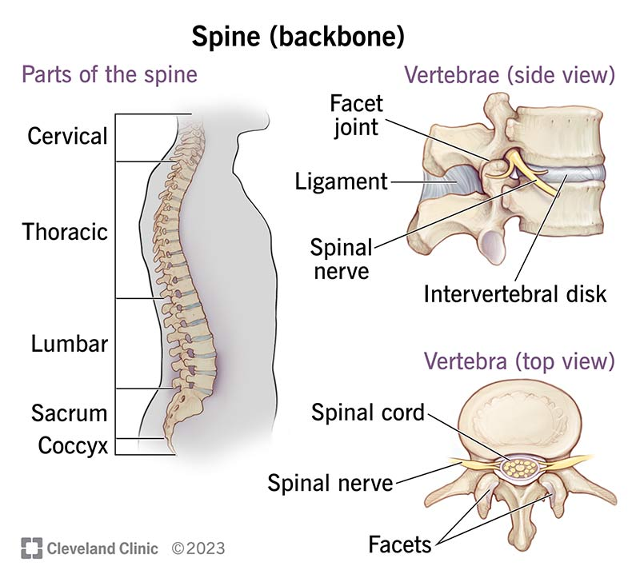
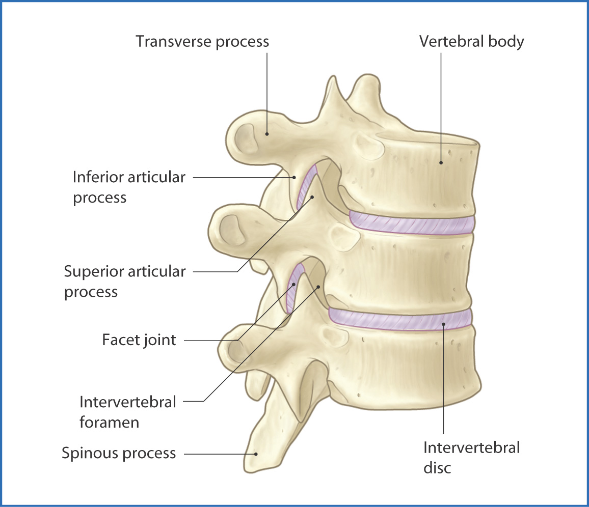
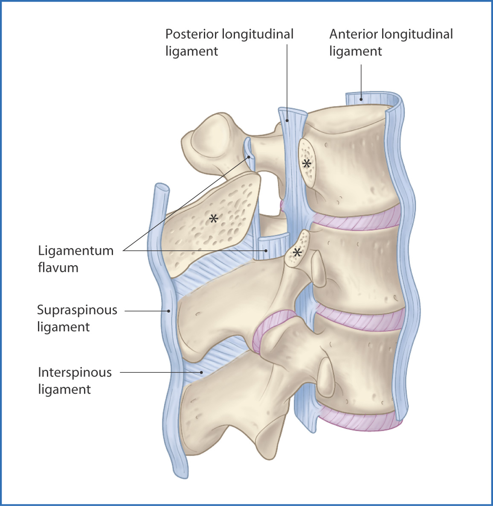
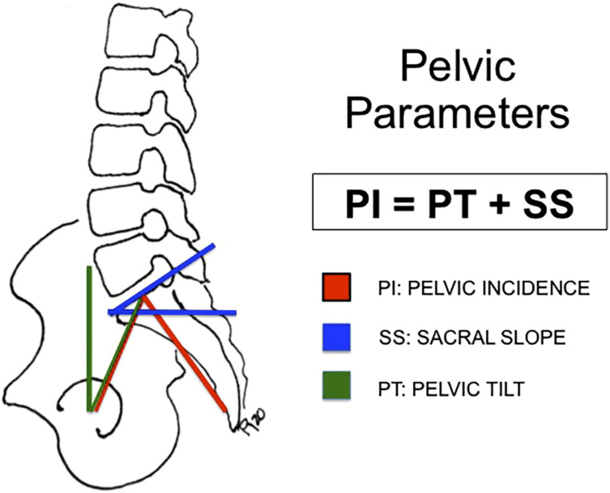

## Vertebral anatomy

Each lumbar vertebra has an anterior weight-bearing body and a posterior arch, formed by paired pedicles and laminae that enclose the spinal canal. The arch bears the spinous process, transverse processes, and superior and inferior articular processes, which form the facet joints. The vertebral bodies from L1 to L5 enlarge caudally, while L4–L5 take on transitional features that shape lower-lumbar loading.

::: {.callout-note}
## Key idea

The immature spine's open growth plates and secondary ossification centers make it more susceptible to injury. This is one reason spondylolysis often begins in childhood or adolescence.
:::

<figure class="figure text-center">

<figcaption>Source: <a href="https://orthoeducation.com/spineeducation/anatomy-of-the-spine/">OrthoEducation</a>.</figcaption>
</figure>

## Intervertebral discs

A disc sits between each pair of adjacent vertebral bodies, including L5–S1. It contains a hydrated central nucleus pulposus within a fibrous annulus fibrosus. Together, these structures absorb axial and torsional loads while permitting motion.

With aging, the nucleus dehydrates and the annulus develops fissures. The resulting loss of disc height shifts load posteriorly onto the facet joints.

<figure class="figure text-center">

<figcaption>Source: <a href="https://basicmedicalkey.com/vertebral-column/">Basic Medical Key</a>.</figcaption>
</figure>

## Facet joints

The facet joints are paired synovial joints in which the inferior articular process above meets the superior articular process below. They are innervated by medial branches of the dorsal rami. Together with the disc, they resist forward translation.

Degeneration progresses from synovitis to cartilage loss, capsular laxity, subluxation, and articular-process hypertrophy. The resulting facet incompetence permits the slippage seen in degenerative spondylolisthesis.

::: {.callout-note}
## Key idea

Sagittally oriented facet joints are more permissive of forward slip and are a recognized anatomic risk factor for degenerative spondylolisthesis.
:::

## Pars interarticularis

The pars interarticularis is the narrow bony bridge linking the superior and inferior articular processes. It is a structural weak point of the posterior arch. Positioned between the anterior body load and posterior articular elements, it absorbs concentrated stress during repetitive extension and rotation, predisposing it to fatigue fracture, most often at L5.

A bilateral pars defect removes the bony restraint against forward slip, allowing progression to isthmic spondylolisthesis.

## Spinal ligaments

The anterior and posterior longitudinal ligaments, ligamentum flavum, and interspinous and supraspinous ligaments stabilize each functional spinal unit. With disc-height loss, the ligamentum flavum and posterior longitudinal ligament buckle and hypertrophy, encroaching on the canal. Interspinous bursitis is a recognized marker of developing degenerative spondylolisthesis.

<figure class="figure text-center">

<figcaption>Source: <a href="https://basicmedicalkey.com/vertebral-column/">Basic Medical Key</a>.</figcaption>
</figure>

## Neural elements

The spinal cord ends near L1; below this lies the cauda equina. Each lumbar root exits its foramen beneath the correspondingly numbered pedicle, such as the L2 root exiting below the L2 pedicle. This relationship provides the basis for correlating radicular symptoms with spinal level.

Slippage narrows the canal, lateral recesses, and foramina, compounding compression from disc protrusion, facet hypertrophy, and ligamentum flavum buckling.

## Lumbosacral anatomy

The lower lumbar segments carry most of the axial load and are most affected by degeneration and slippage. The transition from the mobile lumbar spine to the fixed sacrum, together with the anteriorly inclined sacral endplate, generates shear that predisposes L5 to forward translation.

Isthmic slips predominate at L5–S1, while degenerative slips predominate at L4–L5.

::: {.callout-tip}
## Pause and think

Why is the pars interarticularis particularly sensitive to developing spondylolysis?

Show answer

The pars sits at the junction between the anteriorly directed load of the vertebral body and the posterior articular processes, so it absorbs concentrated stress during repetitive extension and rotation. This makes it the structural weak point of the posterior arch and the site prone to fatigue fracture, most often at L5. Losing this bony bridge on both sides removes the restraint against forward slip.

:::

## Spinopelvic anatomy and alignment

Pelvic orientation drives sagittal balance and is measured on standing full-length lateral radiographs. Pelvic incidence (PI) is a fixed morphologic angle that governs pelvic tilt (PT) and sacral slope (SS):

$$\mathrm{PI} = \mathrm{PT} + \mathrm{SS}$$

Mean asymptomatic values are approximately 55° for PI, 41° for SS, and 13° for PT, with lumbar lordosis tracking these parameters. A high PI raises lumbosacral shear and is associated with both isthmic spondylolysis and the onset or progression of spondylolisthesis. Because abnormal parameters also affect fusion outcomes, they are integral to surgical planning.

<figure class="figure text-center">

<figcaption>Source: <a href="https://pmc.ncbi.nlm.nih.gov/articles/PMC12254617/">PMC</a>.</figcaption>
</figure>

 

::: {.sl-pagination}
[← Previous: Introduction](spondylolisthesis-introduction.qmd){.btn .btn-outline-primary}

[All Modules](modules.qmd){.btn .btn-outline-secondary}

[Next: Classification and Etiology →](spondylolisthesis-classification-etiology.qmd){.btn .btn-primary}
:::